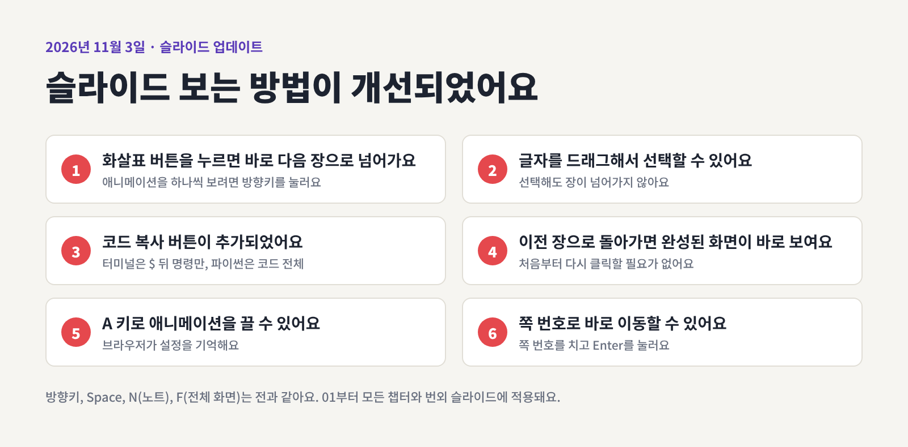
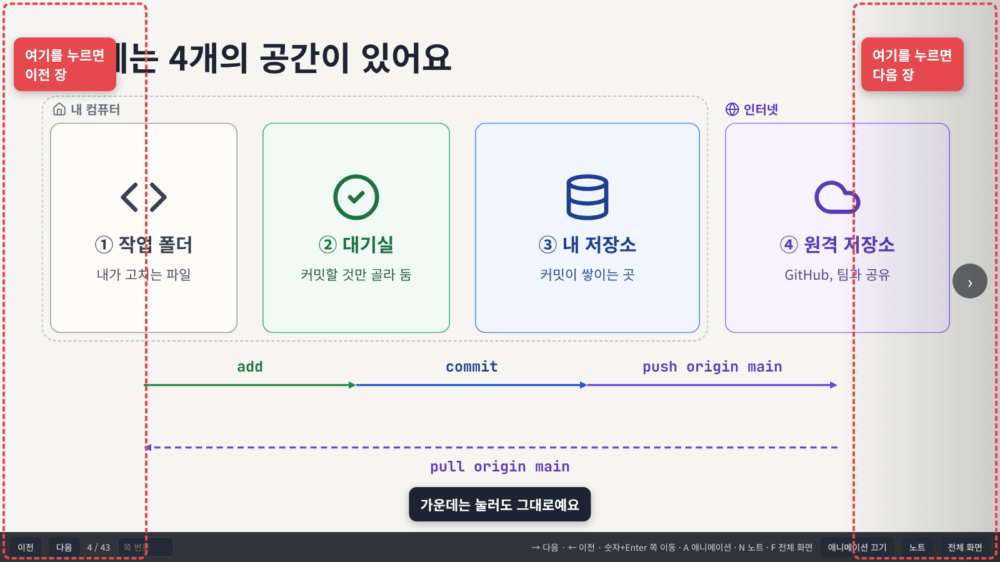
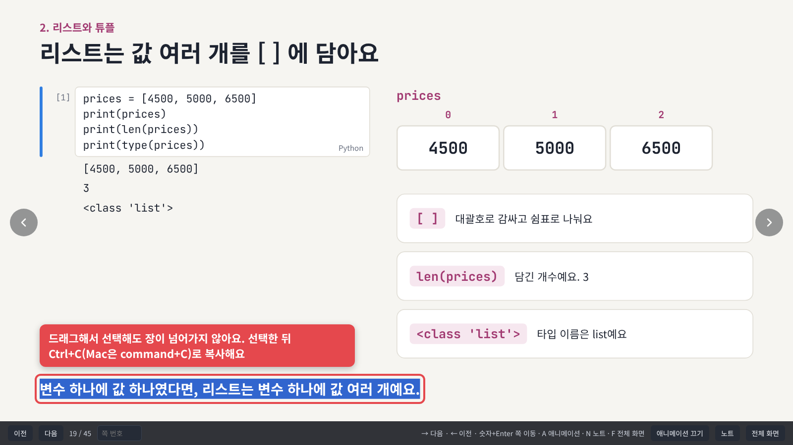
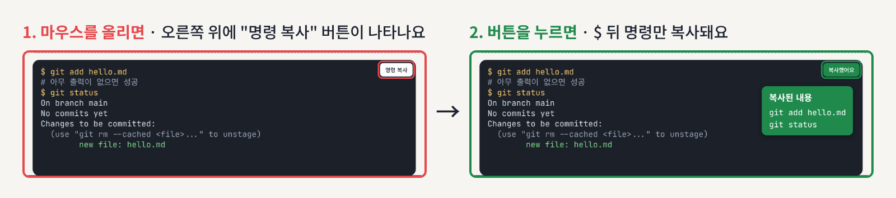
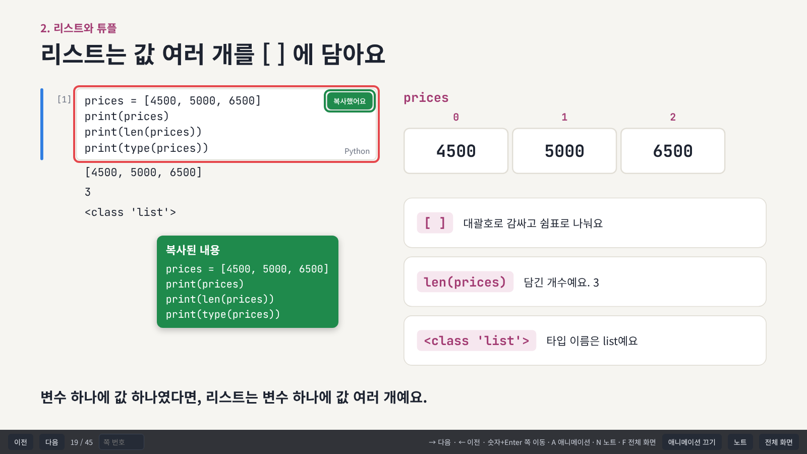
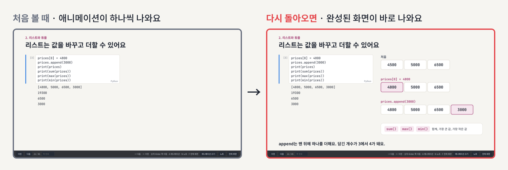
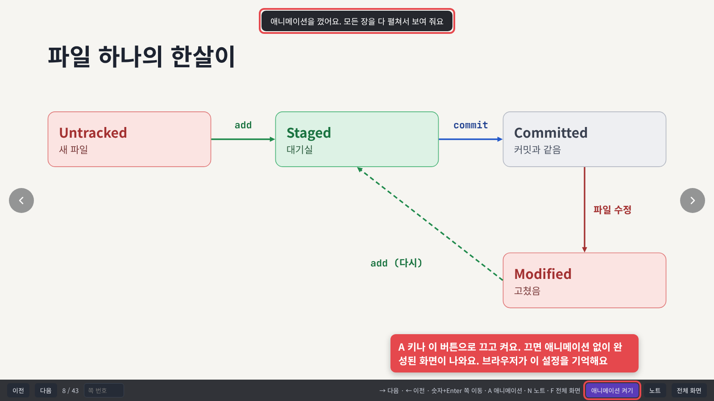
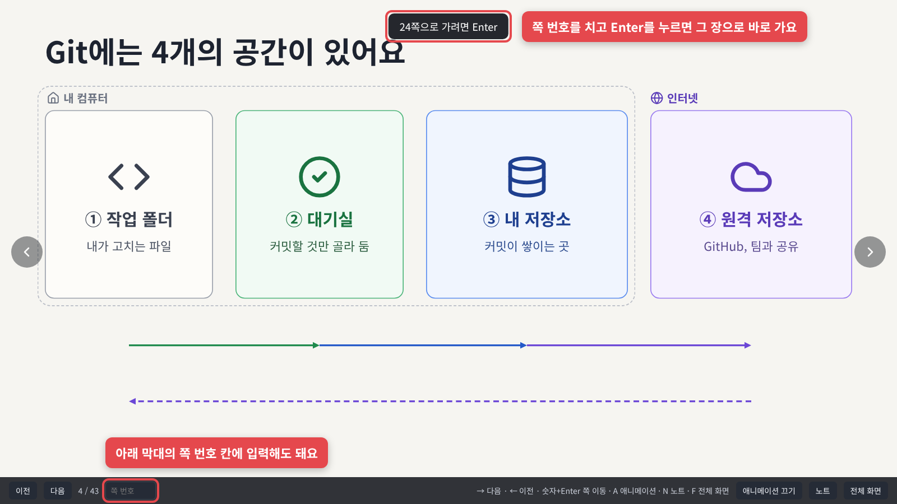
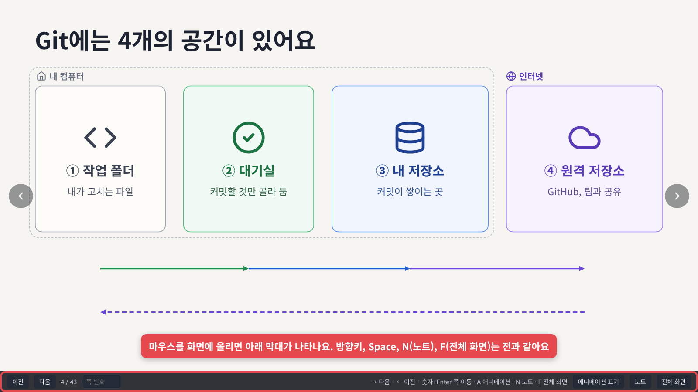

# 2026-11-03 · 슬라이드 보는 방법이 개선되었어요

"글자를 복사하려고 눌렀더니 장이 넘어가요"라는 이야기를 듣고 슬라이드 조작 방법을 개선했어요. 01부터 마지막 챕터, 번외까지 모든 슬라이드에 똑같이 적용돼요. 슬라이드 내용은 그대로예요.



## 바뀐 점

1. [페이지 넘김이 화면 양쪽 끝 클릭으로 바뀌었어요](#1-페이지-넘김이-화면-양쪽-끝-클릭으로-바뀌었어요)
2. [글자를 드래그해서 선택할 수 있어요](#2-글자를-드래그해서-선택할-수-있어요)
3. [코드 복사 버튼이 추가되었어요](#3-코드-복사-버튼이-추가되었어요)
4. [이전 장으로 돌아가면 완성된 화면이 바로 보여요](#4-이전-장으로-돌아가면-완성된-화면이-바로-보여요)
5. [A 키로 애니메이션을 끌 수 있어요](#5-a-키로-애니메이션을-끌-수-있어요)
6. [쪽 번호로 바로 이동할 수 있어요](#6-쪽-번호로-바로-이동할-수-있어요)
7. [그대로 쓰는 기능](#7-그대로-쓰는-기능)

## 1. 페이지 넘김이 화면 양쪽 끝 클릭으로 바뀌었어요

전에는 화면 아무 데나 클릭하면 다음 장으로 넘어갔어요. 이제는 왼쪽 끝을 클릭하면 이전 장, 오른쪽 끝을 클릭하면 다음 장으로 가요. 끝에 마우스를 올리면 동그란 화살표가 나타나요.



## 2. 글자를 드래그해서 선택할 수 있어요

화면 가운데를 클릭하거나 글자를 드래그해서 선택해도 장이 넘어가지 않아요. 선택한 글자는 `Ctrl+C`(Mac은 `command+C`)로 복사해요.



## 3. 코드 복사 버튼이 추가되었어요

코드 칸에 마우스를 올리면 오른쪽 위에 복사 버튼이 떠요. 누르면 버튼이 초록색 "복사했어요"로 바뀌어요.

터미널 칸은 `$ ` 뒤의 명령만 복사해요. 출력과 `#` 설명 줄은 빠지니까 터미널에 그대로 붙여 넣으면 돼요.



파이썬 셀은 코드 전체를 복사해요. 노트북 셀이나 `main.py`에 붙여 넣어요.



## 4. 이전 장으로 돌아가면 완성된 화면이 바로 보여요

처음 보는 장은 수업 때처럼 애니메이션이 하나씩 나와요. 앞 장으로 돌아가면 애니메이션이 끝난 완성된 화면이 바로 나와요. 실수로 넘겼다가 돌아와도 처음부터 다시 클릭할 필요가 없어요.



## 5. A 키로 애니메이션을 끌 수 있어요

복습할 때는 `A` 키나 아래 막대의 "애니메이션 끄기" 버튼으로 애니메이션을 꺼요. 끄면 애니메이션 없이 완성된 화면이 바로 나와서, 한 번 누를 때마다 한 장씩 넘어가요. 브라우저가 이 설정을 기억해서 다음에 열어도 꺼져 있어요. 다시 켜려면 `A`를 한 번 더 눌러요.



## 6. 쪽 번호로 바로 이동할 수 있어요

`2` `4`를 치고 `Enter`를 누르면 24장으로 바로 가요. 숫자를 치면 화면 위에 "24쪽으로 가려면 Enter"라는 안내가 나와요. 잘못 쳤으면 `Esc`로 지워요. 아래 막대의 쪽 번호 칸에 입력해도 돼요.



## 7. 그대로 쓰는 기능

마우스를 화면에 올리면 아래 막대가 나타나요. 키보드 조작은 전과 같아요.



| 키 | 동작 |
| --- | --- |
| `→` `Space` | 다음 |
| `←` | 이전 |
| 숫자 뒤 `Enter` | 그 장으로 가기 |
| `A` | 애니메이션 끄고 켜기 |
| `N` | 발표자 노트 열고 닫기 |
| `F` | 전체 화면 |

화면 가운데를 클릭해서 넘기던 분은 이제 왼쪽, 오른쪽 끝을 클릭해요. 방향키와 프레젠터 리모컨은 전처럼 쓰면 돼요.

## 강사용

스크린샷은 실제 덱(02, 13)을 헤드리스 브라우저로 열어서 찍었어요. 플레이어(`tools/build_player.js`)가 바뀌면 레포 맨 위에서 다시 찍어요.

```bash
node updates/2026-11-03-slide-player/tools/shots.js
```

---

<!-- curriculum:nav -->

[릴리스 노트 목록](../README.md) · [커리큘럼](../../README.md)

<!-- /curriculum:nav -->
