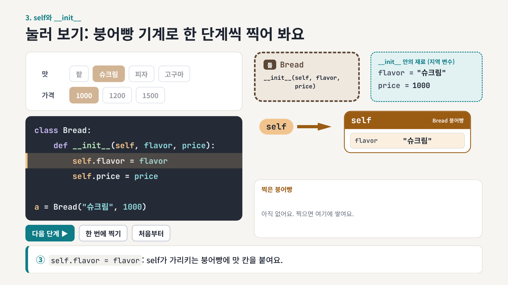
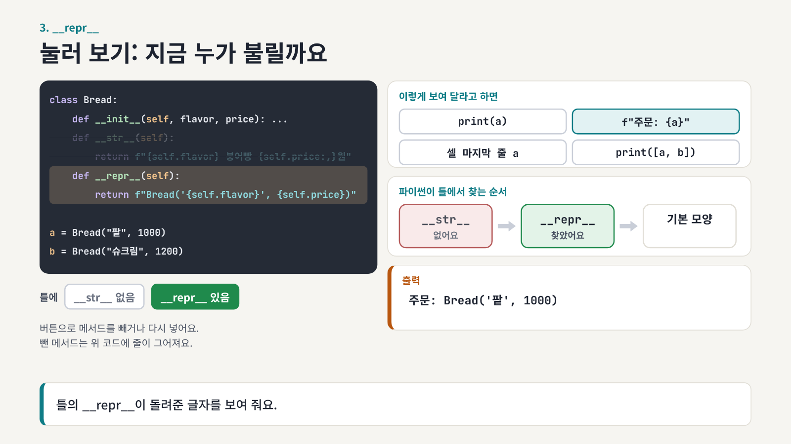
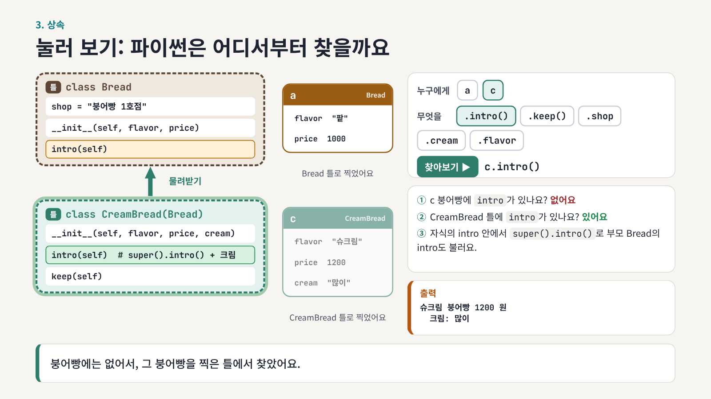

# 2026-11-05 · 클래스 슬라이드에 직접 눌러 보는 장이 추가되었어요

"self와 `__init__`이 머릿속에서 잘 안 그려져요"라는 이야기를 듣고, 클래스 세 챕터(24, 25, 26)에 직접 눌러 보며 따라가는 장을 하나씩 넣었어요. 버튼을 누르면 코드가 한 줄씩 실행되는 모습과 파이썬이 메서드를 찾는 순서가 그림으로 움직여요.

버튼은 브라우저로 연 슬라이드에서 눌러져요. 다른 장은 전처럼 방향키와 화살표 버튼으로 넘겨요.

## 추가된 장

1. [붕어빵 기계 (24, 17쪽)](#1-붕어빵-기계-24-17쪽)
2. [누가 불릴까 (25, 14쪽)](#2-누가-불릴까-25-14쪽)
3. [파이썬은 어디서부터 찾을까 (26, 17쪽)](#3-파이썬은-어디서부터-찾을까-26-17쪽)
4. [움직이는 그림](#4-움직이는-그림)

## 1. 붕어빵 기계 (24, 17쪽)

맛과 가격을 고르고 "한 단계씩"을 누르면 `a = Bread("팥", 1000)`이 다섯 단계로 실행돼요. 왼쪽 코드에서는 지금 실행하는 줄에 불이 들어와요. 오른쪽에서는 빈 붕어빵이 생기고, `self`가 그 붕어빵을 가리키고, 칸이 하나씩 붙어요. 한 번 더 찍으면 `self`가 새 붕어빵을 가리키는 것도 볼 수 있어요.



## 2. 누가 불릴까 (25, 14쪽)

`print(a)`, f-string, 셀 마지막 줄, `print([a, b])` 중 하나를 누르면 파이썬이 틀에서 `__str__`, `__repr__`, 기본 모양을 어떤 순서로 찾는지 상자에 차례로 불이 들어와요. 왼쪽 아래 버튼으로 `__str__`이나 `__repr__`을 빼고 다시 눌러 볼 수 있어요.



## 3. 파이썬은 어디서부터 찾을까 (26, 17쪽)

붕어빵 `a`나 `c`를 고르고 `.intro()`, `.keep()`, `.shop` 같은 것을 물어보면, 붕어빵 자신, 그 붕어빵을 찍은 틀, 부모 틀 순서로 찾아 올라가요. 끝까지 없으면 실제와 같은 `AttributeError`가 나와요.



## 4. 움직이는 그림

24의 12쪽에서는 괄호 안의 `"팥"`과 `1000`이 `__init__`의 칸으로 날아가요. 24의 16쪽과 26의 13쪽에서는 단계마다 붕어빵이 그 단계 줄에서 날아와 칸이 늘어나요. 방향키로 한 단계씩 넘기면 보여요.

## 강사용

눌러 보기 장에 나오는 출력은 각 챕터의 `tools/run_nb.py`로 실제로 실행한 결과예요. 스크린샷은 실제 덱을 헤드리스 브라우저로 열어 버튼을 누르고 찍었어요. 덱이 바뀌면 레포 맨 위에서 다시 찍어요.

```bash
node updates/2026-11-05-class-labs/tools/shots.js
```

---

<!-- curriculum:nav -->

[릴리스 노트 목록](../README.md) · [커리큘럼](../../README.md)

<!-- /curriculum:nav -->
