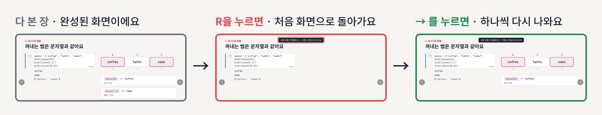
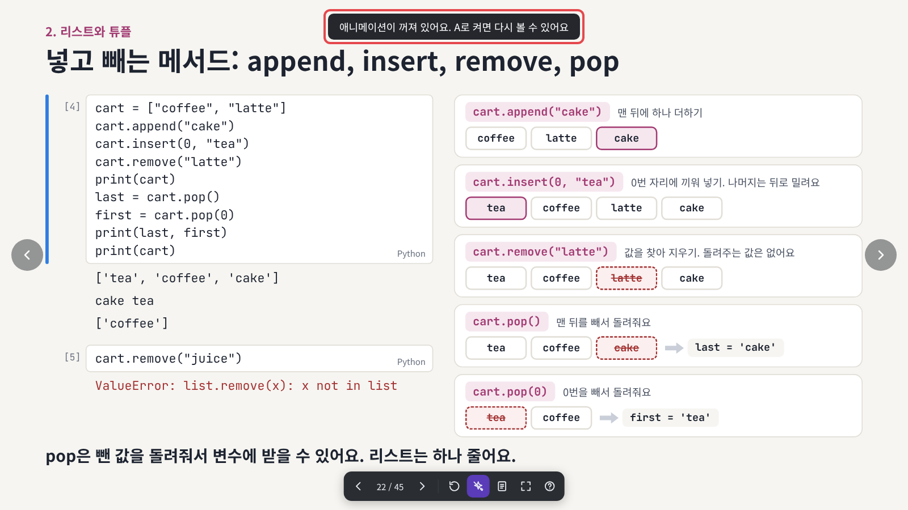
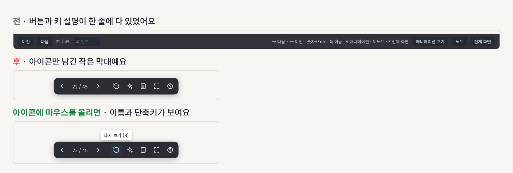
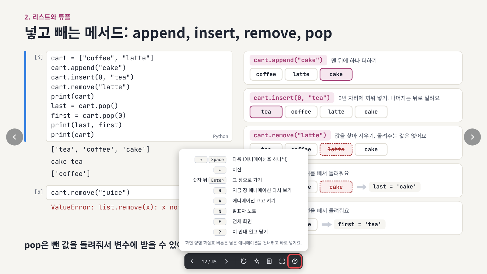

# 2026-11-08 · 애니메이션 다시 보기가 추가되고 아래 막대가 간단해졌어요

한 번 본 장의 애니메이션을 처음부터 다시 볼 수 있어요. 화면 아래 막대도 아이콘만 남겨서 작고 깔끔해졌어요. 01부터 마지막 챕터, 번외까지 모든 슬라이드에 똑같이 적용돼요. 슬라이드 내용은 그대로예요.

## 바뀐 점

1. [R 키로 애니메이션을 다시 볼 수 있어요](#1-r-키로-애니메이션을-다시-볼-수-있어요)
2. [아래 막대가 간단해졌어요](#2-아래-막대가-간단해졌어요)
3. [? 버튼으로 단축키를 볼 수 있어요](#3--버튼으로-단축키를-볼-수-있어요)

## 1. R 키로 애니메이션을 다시 볼 수 있어요

다시 보고 싶은 장에서 `R`을 누르면 그 장이 애니메이션 전 처음 화면으로 돌아가요. 화면 위에 "처음 화면으로 돌렸어요"라는 안내가 나와요. 그다음 `→`나 `Space`를 누를 때마다 애니메이션이 하나씩 다시 나와요. 마우스로는 아래 막대의 다시 보기 버튼(↻)을 눌러요.

앞 장으로 돌아가면 전처럼 완성된 화면이 바로 나와요. 다시 보고 싶을 때만 `R`을 눌러요.

`A`로 애니메이션을 꺼 둔 상태에서는 다시 볼 애니메이션이 없어요. 이때 `R`을 누르면 "A로 켜면 다시 볼 수 있어요"라는 안내가 나와요.

## 2. 아래 막대가 간단해졌어요

마우스를 화면에 올리면 아래 가운데에 작은 막대가 나타나요. 버튼 글자와 키 설명을 빼고 아이콘만 남겼어요. 아이콘에 마우스를 올리면 이름과 단축키가 보여요.

| 아이콘 | 하는 일 |
| --- | --- |
| ‹ › | 이전, 다음 (애니메이션을 하나씩) |
| `22 / 45` | 누르고 숫자를 친 뒤 `Enter`로 그 장에 가요 |
| ↻ | 지금 장 애니메이션 다시 보기 |
| ✦ | 애니메이션 끄고 켜기 (끄면 보라색) |
| 노트 아이콘 | 발표자 노트 열고 닫기 |
| 네 모서리 아이콘 | 전체 화면 |
| ? | 단축키 안내 열고 닫기 |

## 3. ? 버튼으로 단축키를 볼 수 있어요

막대의 `?` 버튼이나 키보드 `?`를 누르면 단축키 표가 열려요. `Esc`나 `?`를 한 번 더 누르면 닫혀요.

| 키 | 동작 |
| --- | --- |
| `→` `Space` | 다음 (애니메이션을 하나씩) |
| `←` | 이전 |
| 숫자 뒤 `Enter` | 그 장으로 가기 |
| `R` | 지금 장 애니메이션 다시 보기 |
| `A` | 애니메이션 끄고 켜기 |
| `N` | 발표자 노트 열고 닫기 |
| `F` | 전체 화면 |
| `?` | 단축키 안내 열고 닫기 |

## 강사용

스크린샷은 실제 덱(13)을 헤드리스 브라우저로 열어서 찍었어요. 플레이어(`tools/build_player.js`)가 바뀌면 레포 맨 위에서 `node updates/2026-11-08-slide-replay/tools/shots.js`로 다시 찍어요. 막대 전후 비교에는 예전 플레이어로 만든 13 덱 HTML 경로를 `BEFORE_HTML`로 같이 줘요.

---

<!-- curriculum:nav -->

[릴리스 노트 목록](../README.md) · [커리큘럼](../../README.md)

<!-- /curriculum:nav -->
