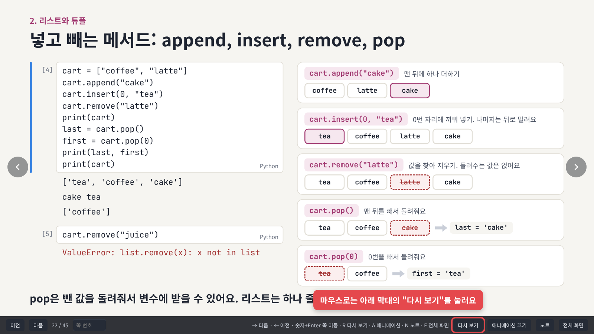
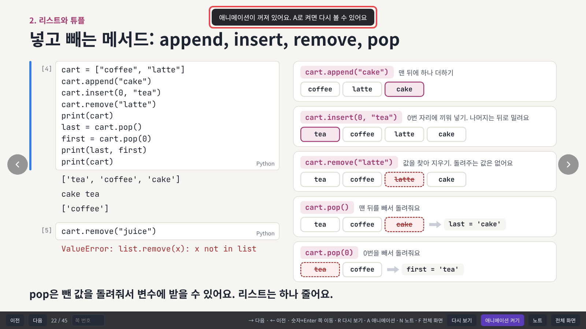

# 2026-11-08 · 애니메이션을 다시 볼 수 있게 되었어요

한 번 본 장의 애니메이션을 처음부터 다시 볼 수 있어요. `R` 키를 누르거나 아래 막대의 "다시 보기" 버튼을 누르면 그 장이 처음 화면으로 돌아가요. 그다음 `→`나 `Space`를 누르면 애니메이션이 하나씩 다시 나와요. 01부터 마지막 챕터, 번외까지 모든 슬라이드에 똑같이 적용돼요. 슬라이드 내용은 그대로예요.

## 이렇게 써요

1. 다시 보고 싶은 장에서 `R`을 눌러요. 화면 위에 "처음 화면으로 돌렸어요"라는 안내가 나와요.
2. `→`나 `Space`를 누를 때마다 애니메이션이 하나씩 나와요.
3. 다른 장으로 넘어갔다 돌아와도 원하면 언제든 다시 `R`을 눌러요.

## 마우스로는 "다시 보기" 버튼을 눌러요

화면에 마우스를 올리면 아래 막대가 나타나요. "애니메이션 끄기" 왼쪽의 "다시 보기"를 누르면 `R`과 똑같이 처음 화면으로 돌아가요.

## 애니메이션을 꺼 둔 경우

`A`로 애니메이션을 꺼 두면 장마다 완성된 화면만 보여 줘서 다시 볼 애니메이션이 없어요. 이때 `R`을 누르면 "A로 켜면 다시 볼 수 있어요"라는 안내가 나와요. `A`를 한 번 더 눌러 켠 뒤 `R`을 눌러요.

## 그대로 쓰는 기능

앞 장으로 돌아가면 전처럼 완성된 화면이 바로 나와요. 복습할 때 처음부터 다시 클릭하지 않아도 돼요. 다시 보고 싶을 때만 `R`을 눌러요.

| 키 | 동작 |
| --- | --- |
| `→` `Space` | 다음 (애니메이션을 하나씩) |
| `←` | 이전 |
| 숫자 뒤 `Enter` | 그 장으로 가기 |
| `R` | 지금 장 애니메이션 다시 보기 |
| `A` | 애니메이션 끄고 켜기 |
| `N` | 발표자 노트 열고 닫기 |
| `F` | 전체 화면 |

## 강사용

스크린샷은 실제 덱(13)을 헤드리스 브라우저로 열어서 찍었어요. 플레이어(`tools/build_player.js`)가 바뀌면 레포 맨 위에서 `node updates/2026-11-08-slide-replay/tools/shots.js`로 다시 찍어요.

---

<!-- curriculum:nav -->

[릴리스 노트 목록](../README.md) · [커리큘럼](../../README.md)

<!-- /curriculum:nav -->
