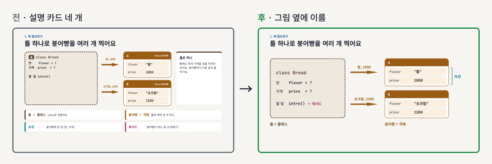
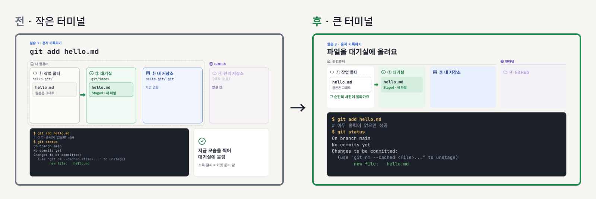
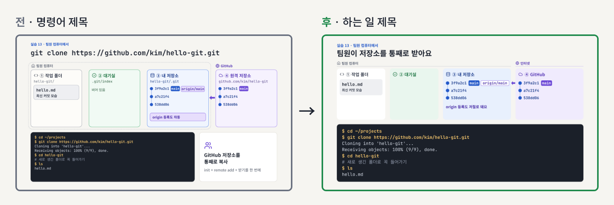

# 2026-11-09 · 모든 챕터 슬라이드를 새로 디자인했어요

01~26 모든 챕터와 번외 슬라이드를 다시 만들었어요. 내용과 실습 명령은 같아요.

## 바뀐 점

1. [장마다 볼 것을 하나로 줄였어요](#1-장마다-볼-것을-하나로-줄였어요)
2. [코드와 터미널 글씨를 키웠어요](#2-코드와-터미널-글씨를-키웠어요)
3. [제목에 그 장에서 하는 일을 적었어요](#3-제목에-그-장에서-하는-일을-적었어요)
4. [쪽 번호가 바뀐 챕터가 있어요](#4-쪽-번호가-바뀐-챕터가-있어요)

## 1. 장마다 볼 것을 하나로 줄였어요

설명 카드를 빼고, 용어는 그림 옆에 바로 적었어요.

## 2. 코드와 터미널 글씨를 키웠어요

## 3. 제목에 그 장에서 하는 일을 적었어요

명령어는 터미널 칸에 그대로 있어요.

## 4. 쪽 번호가 바뀐 챕터가 있어요

| 챕터 | 전 | 후 |
| --- | --- | --- |
| 04 Git diff | 25장 | 27장 |
| 05 Git Graph | 23장 | 26장 |
| 06 팀 레포 | 41장 | 40장 |
| 08 합치는 방법 비교 | 31장 | 34장 |
| 09 uv | 32장 | 35장 |
| 10 Jupyter 노트북 | 27장 | 31장 |
| 11 gh | 36장 | 37장 |
| 12 파이썬 기초 1 | 39장 | 40장 |
| 13 파이썬 기초 2 | 45장 | 40장 |
| 14 파이썬 기초 3 | 22장 | 26장 |
| 15 파이썬 기초 4 | 26장 | 29장 |

나머지 챕터는 쪽 번호가 같아요.

## 함께 바뀐 조작

- [`R` 다시 보기, 아이콘 막대, `?` 단축키 안내](../2026-11-08-slide-replay)
- [발표자 노트 옮기기와 크기 바꾸기](../2026-11-09-notes-window)

## 강사용

전후 스크린샷은 다시 만들기 전 main 커밋(`4c4189d`)과 지금 HTML을 같은 쪽 번호로 열어 찍었어요. 레포 맨 위에서 `node updates/2026-11-09-deck-redesign/tools/shots.js`로 다시 찍어요. 다른 커밋과 비교하려면 `BEFORE_REV`를 줘요.

---

<!-- curriculum:nav -->

[릴리스 노트 목록](../README.md) · [커리큘럼](../../README.md)

<!-- /curriculum:nav -->
