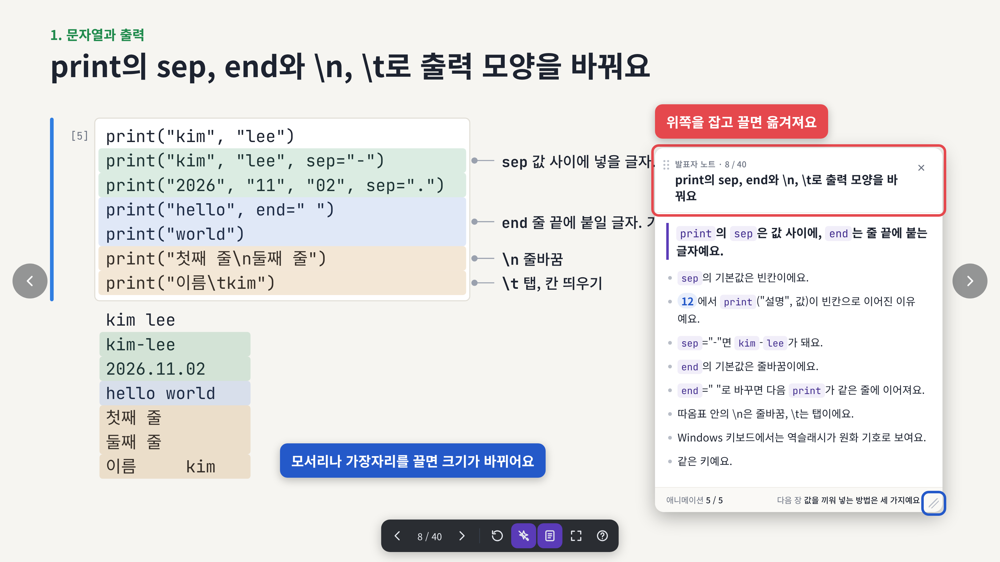
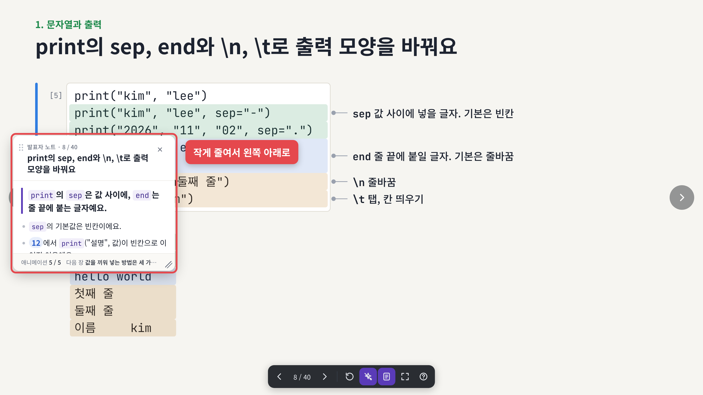
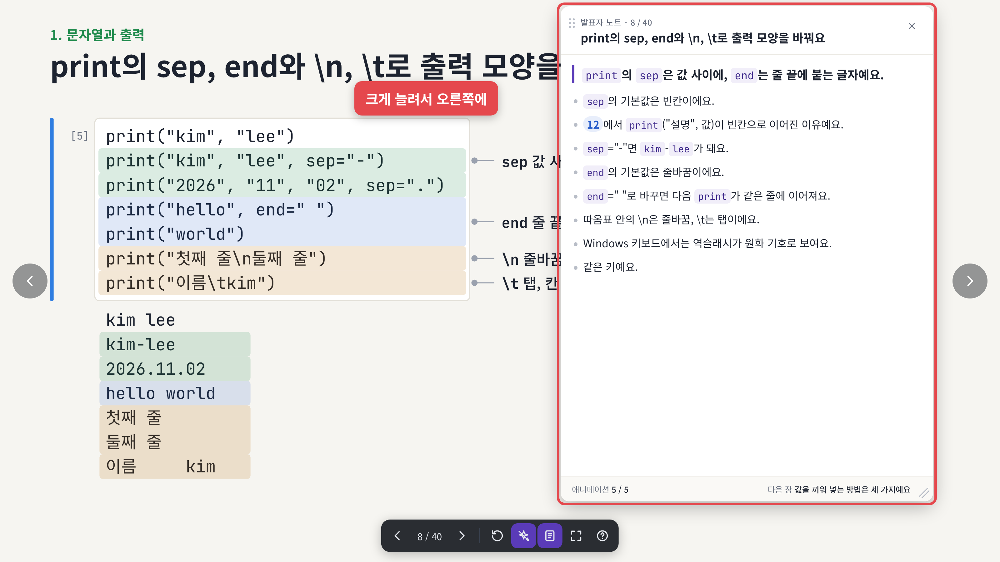

# 2026-11-09 · 발표자 노트를 원하는 자리로 옮기고 크기를 바꿀 수 있어요

발표자 노트 카드를 컴퓨터 창처럼 다룰 수 있게 되었어요. 슬라이드 내용을 가리면 옆으로 옮기고, 글이 길면 크게 늘려서 봐요. 01부터 마지막 챕터, 번외까지 모든 슬라이드에 똑같이 적용돼요. 슬라이드 내용은 그대로예요.

## 바뀐 점

1. [위쪽을 끌면 노트가 옮겨져요](#1-위쪽을-끌면-노트가-옮겨져요)
2. [가장자리를 끌면 크기가 바뀌어요](#2-가장자리를-끌면-크기가-바뀌어요)
3. [옮긴 자리와 크기를 기억해요](#3-옮긴-자리와-크기를-기억해요)

## 1. 위쪽을 끌면 노트가 옮겨져요

`N`으로 노트를 연 뒤 카드 위쪽(쪽 번호와 제목이 있는 칸)을 마우스로 잡고 끌어요. 왼쪽 위의 점 여섯 개가 잡는 자리라는 표시예요. 카드는 화면 밖으로 나가지 않아요.

## 2. 가장자리를 끌면 크기가 바뀌어요

카드의 네 변이나 네 모서리에 마우스를 올리면 화살표 모양이 바뀌어요. 그때 끌면 크기가 바뀌어요. 오른쪽 아래 모서리에는 빗금 표시가 있어요.

작게 줄여서 구석에 두면 슬라이드를 가리지 않아요.

수업 준비를 할 때는 크게 늘려서 노트를 한눈에 봐요.

## 3. 옮긴 자리와 크기를 기억해요

장을 넘겨도, 새로 고침을 해도 노트는 옮긴 자리와 크기 그대로 열려요. 다른 챕터 슬라이드에서도 같은 자리에 열려요. 처음 자리로 돌리고 싶으면 카드 위쪽을 두 번 눌러요.

휴대폰처럼 좁은 화면에서는 전처럼 아래쪽에 고정된 카드로 보여요.

## 강사용

스크린샷은 실제 덱(13)을 헤드리스 브라우저로 열어서 찍었어요. 플레이어(`tools/build_player.js`)가 바뀌면 레포 맨 위에서 `node updates/2026-11-09-notes-window/tools/shots.js`로 다시 찍어요.

---

<!-- curriculum:nav -->

[릴리스 노트 목록](../README.md) · [커리큘럼](../../README.md)

<!-- /curriculum:nav -->
