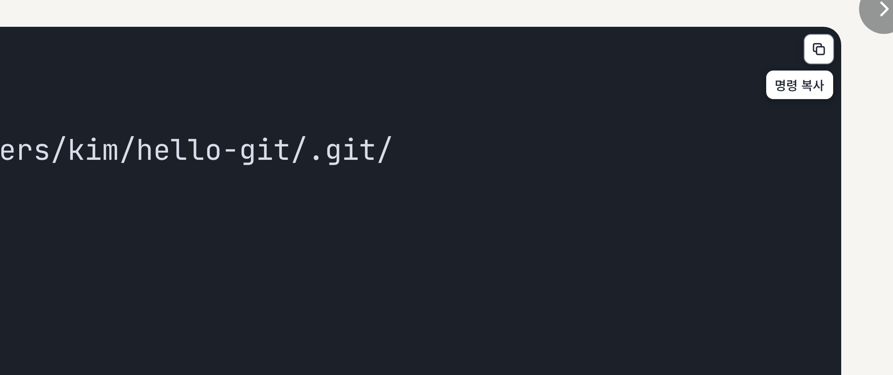
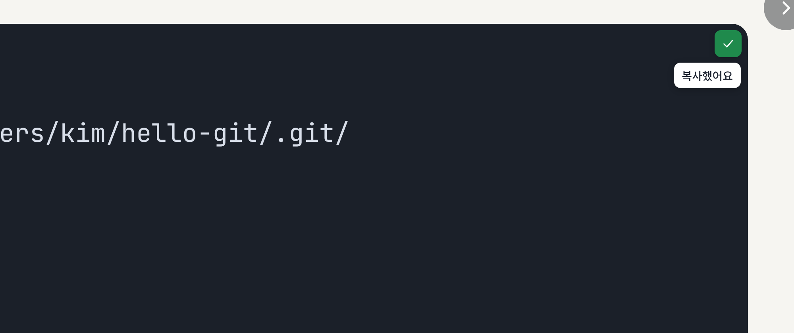
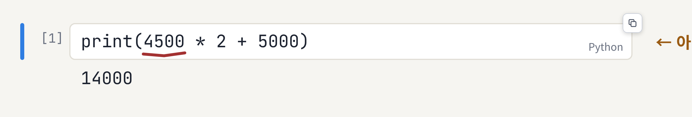

# 2026-11-13 · 코드 복사 버튼이 아이콘으로 깔끔해졌어요

코드 칸 오른쪽 위에 뜨던 "복사" 글자 버튼이 작은 복사 아이콘으로 바뀌었어요. 버튼이 작아져서 코드를 덜 가려요. 01부터 마지막 챕터, 번외까지 모든 슬라이드에 똑같이 적용돼요. 슬라이드 내용은 그대로예요.

## 바뀐 점

1. [코드 칸에 마우스를 올리면 복사 아이콘이 떠요](#1-코드-칸에-마우스를-올리면-복사-아이콘이-떠요)
2. [누르면 체크 표시로 바뀌어요](#2-누르면-체크-표시로-바뀌어요)
3. [아이콘이 코드를 가리지 않는 자리로 가요](#3-아이콘이-코드를-가리지-않는-자리로-가요)

## 1. 코드 칸에 마우스를 올리면 복사 아이콘이 떠요

아이콘에 마우스를 올리면 아래에 무엇을 복사하는지 이름이 나와요. 터미널 칸은 "명령 복사"예요. 전처럼 `$` 뒤의 명령만 복사해요.

## 2. 누르면 체크 표시로 바뀌어요

아이콘을 누르면 초록색 체크 표시로 바뀌고 "복사했어요"가 나와요. 잠시 뒤 다시 복사 아이콘으로 돌아와요.

## 3. 아이콘이 코드를 가리지 않는 자리로 가요

한 줄짜리 짧은 칸처럼 오른쪽 위에 글자가 있으면 아이콘이 칸 아래쪽이나 칸 바깥, 칸 모서리로 자리를 옮겨요. 코드와 "Python" 같은 작은 글자를 가리지 않아요.

## 강사용

스크린샷은 실제 덱(02, 12)을 헤드리스 브라우저로 열어서 찍었어요. 플레이어(`tools/build_player.js`)가 바뀌면 레포 맨 위에서 `node updates/2026-11-13-copy-icon/tools/shots.js`로 다시 찍어요.

---

<!-- curriculum:nav -->

[릴리스 노트 목록](../README.md) · [커리큘럼](../../README.md)

<!-- /curriculum:nav -->
