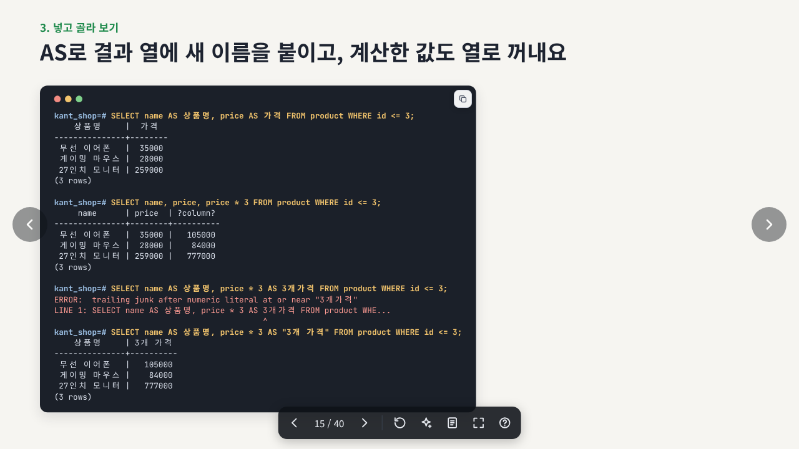
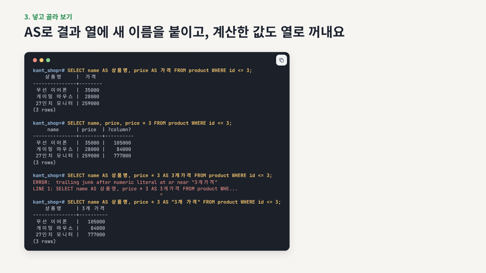
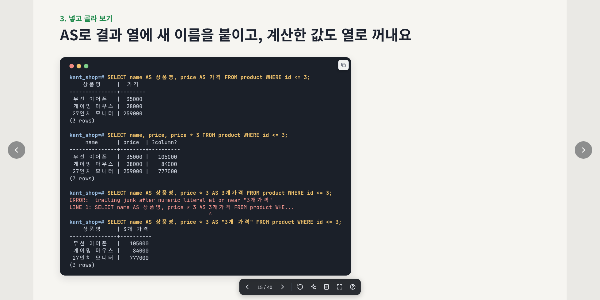
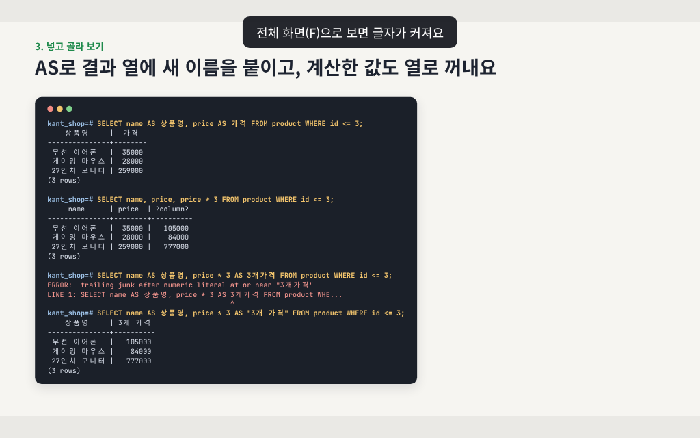
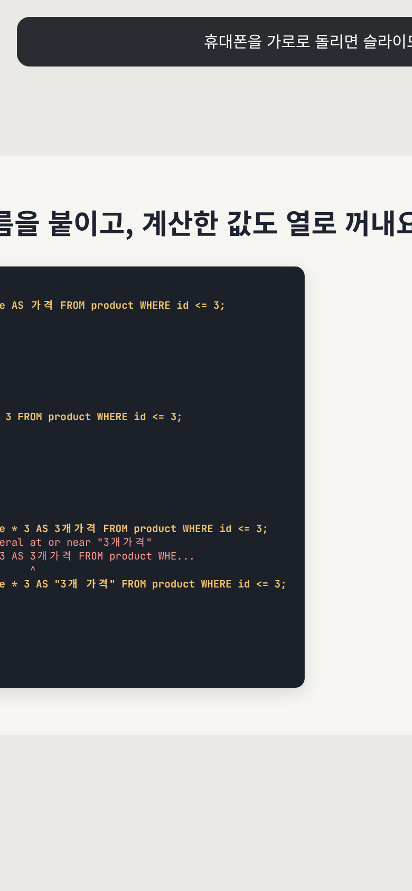

# 2026-11-18 · 어떤 화면에서도 슬라이드를 편하게 볼 수 있어요

노트북, 큰 모니터, 맥북, 휴대폰처럼 화면 크기가 달라도 슬라이드를 편하게 보도록 다듬었어요. 01부터 마지막 챕터, 번외까지 모든 슬라이드에 똑같이 적용돼요. 슬라이드 내용은 그대로예요.

## 바뀐 점

1. [화살표와 아래 막대가 슬라이드를 가리지 않아요](#1-화살표와-아래-막대가-슬라이드를-가리지-않아요)
2. [화면 비율이 달라도 띠가 자연스러워요](#2-화면-비율이-달라도-띠가-자연스러워요)
3. [작은 창에서는 전체 화면을 알려 줘요](#3-작은-창에서는-전체-화면을-알려-줘요)
4. [휴대폰은 가로로 돌려서 봐요](#4-휴대폰은-가로로-돌려서-봐요)

## 1. 화살표와 아래 막대가 슬라이드를 가리지 않아요

마우스를 움직이면 양옆 화살표와 아래 막대가 나타나요.

마우스를 2초 동안 가만히 두면 사라져서 슬라이드 끝까지 다 보여요. 화살표나 막대 위에 마우스를 올려 두는 동안에는 사라지지 않아요.

## 2. 화면 비율이 달라도 띠가 자연스러워요

슬라이드는 어느 화면에서든 16:9 비율 그대로 커지고 작아져요. 맥북처럼 16:10인 화면에는 위아래에, 브라우저 창이 옆으로 길면 양옆에 띠가 생겨요. 띠가 검은색에서 슬라이드 배경과 비슷한 연한 색으로 바뀌었어요. 띠에 자리가 있으면 화살표와 막대가 띠 안으로 옮겨 가요.

## 3. 작은 창에서는 전체 화면을 알려 줘요

창이 작아서 슬라이드가 작게 보이면 처음 한 번 "전체 화면(F)으로 보면 글자가 커져요" 안내가 떠요. 코드 복사 아이콘도 화면에 맞춰 작아지고, 코드를 가리지 않는 자리를 찾아가요.

## 4. 휴대폰은 가로로 돌려서 봐요

휴대폰을 세로로 들면 슬라이드가 아주 작아져요. 위쪽에 가로로 돌려 보라는 안내가 나와요.

## 강사용

스크린샷은 실제 덱(36)을 헤드리스 브라우저로 여러 창 크기에서 열어서 찍었어요. 플레이어(`tools/build_player.js`)가 바뀌면 레포 맨 위에서 `node updates/2026-11-18-screen-size/tools/shots.js`로 다시 찍어요.

---

<!-- curriculum:nav -->

[릴리스 노트 목록](../README.md) · [커리큘럼](../../README.md)

<!-- /curriculum:nav -->
