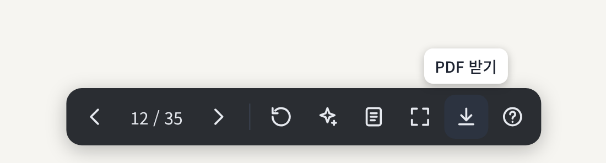
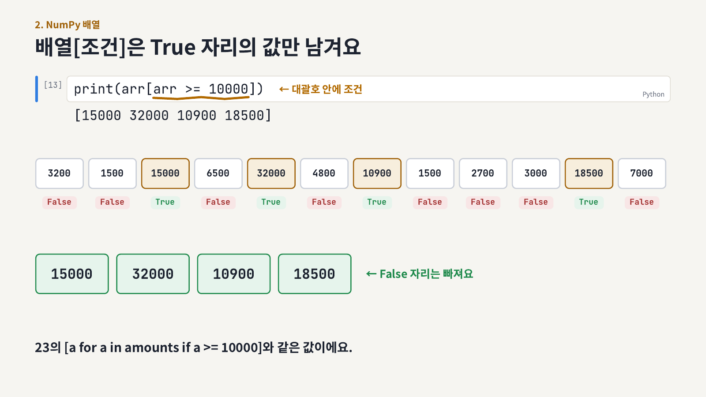

# 2026-11-23 · 챕터마다 슬라이드 PDF를 받을 수 있어요

01부터 마지막 챕터, 번외까지 모든 슬라이드를 PDF로 받을 수 있어요. 인쇄해서 필기하거나, 인터넷이 없는 곳에서 복습할 때 써요. 슬라이드 내용은 그대로예요.

## 바뀐 점

1. [README 표에서 바로 받아요](#1-readme-표에서-바로-받아요)
2. [슬라이드 아래 막대에 PDF 받기 버튼이 생겼어요](#2-슬라이드-아래-막대에-pdf-받기-버튼이-생겼어요)
3. [PDF에는 애니메이션이 끝난 화면이 담겨요](#3-pdf에는-애니메이션이-끝난-화면이-담겨요)

## 1. README 표에서 바로 받아요

맨 위 README 커리큘럼 표의 슬라이드 칸에 "열기" 아래 "PDF"가 생겼어요. 챕터 README 맨 위 표에는 "브라우저로 열기" 옆에 "PDF 받기"가 있어요. 누르면 브라우저에서 PDF가 열리고, 브라우저의 저장 버튼으로 내려받아요.

## 2. 슬라이드 아래 막대에 PDF 받기 버튼이 생겼어요

슬라이드를 보다가 마우스를 움직이면 아래 막대가 나와요. 전체 화면 버튼 옆의 받기 버튼(⤓)을 누르면 보고 있는 덱의 PDF가 바로 내려받아져요.

## 3. PDF에는 애니메이션이 끝난 화면이 담겨요

한 장이 PDF 한 쪽이에요. 애니메이션으로 하나씩 나오던 그림과 강조 표시가 모두 나온 화면으로 담겨요. 직접 눌러 보는 장은 누르기 전 처음 화면이 들어가요.

## 강사용

그림은 실제 덱(45)으로 만들었어요. 플레이어(`tools/build_player.js`)나 45 덱이 바뀌면 레포 맨 위에서 `node updates/2026-11-23-pdf-download/tools/shots.js`로 다시 만들어요.

---

<!-- curriculum:nav -->

[릴리스 노트 목록](../README.md) · [커리큘럼](../../README.md)

<!-- /curriculum:nav -->
