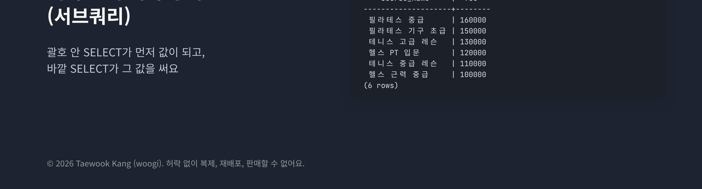
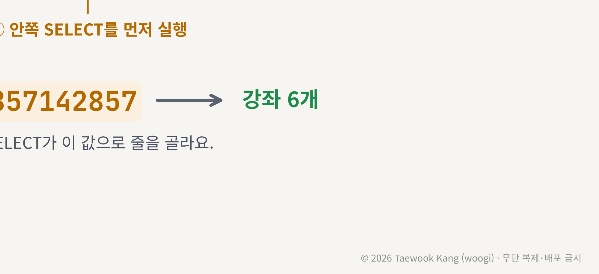
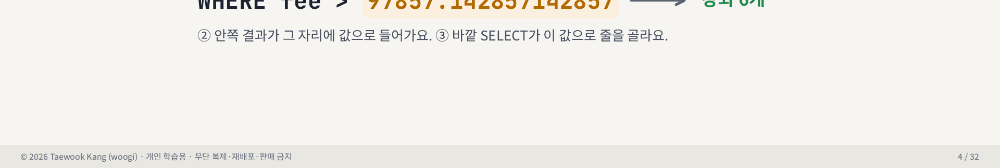

# 2026-11-26 · 슬라이드와 PDF에 저작권 안내가 추가되었어요

모든 챕터와 번외 슬라이드, PDF, 레포에 저작권 안내가 들어갔어요. 슬라이드 내용과 보는 방법은 그대로예요. 혼자 공부하고, PDF를 인쇄하고, 친구에게 주소를 알려 주는 것은 지금처럼 자유롭게 할 수 있어요.

## 바뀐 점

1. [표지 맨 아래에 한 줄이 생겼어요](#1-표지-맨-아래에-한-줄이-생겼어요)
2. [슬라이드 오른쪽 아래에 작은 줄이 생겼어요](#2-슬라이드-오른쪽-아래에-작은-줄이-생겼어요)
3. [PDF 쪽마다 아래 띠가 생겼어요](#3-pdf-쪽마다-아래-띠가-생겼어요)
4. [이용 안내는 NOTICE.md에 있어요](#4-이용-안내는-noticemd에-있어요)

## 1. 표지 맨 아래에 한 줄이 생겼어요

덱 첫 장인 표지 맨 아래에 저작권 안내가 한 줄 들어갔어요. PDF 첫 쪽에도 같은 줄이 있어요.

## 2. 슬라이드 오른쪽 아래에 작은 줄이 생겼어요

표지 다음 장부터는 오른쪽 아래 구석에 작고 흐린 글씨로 들어가요. 슬라이드 글자와 그림을 가리지 않는 자리예요. 창 그림이 화면 끝까지 닿는 장에서는 작은 바탕을 깔아서 글씨가 잘 보여요.

## 3. PDF 쪽마다 아래 띠가 생겼어요

PDF는 쪽마다 슬라이드 아래에 얇은 띠가 붙어요. 왼쪽에 저작권 안내, 오른쪽에 쪽 번호가 있어요. 띠는 슬라이드 바깥에 붙어서 내용을 가리지 않아요. 인쇄해서 필기할 때 쪽 번호로 찾기 쉬워요.

## 4. 이용 안내는 NOTICE.md에 있어요

할 수 있는 것과 허락이 필요한 것은 레포 맨 위 [NOTICE.md](../../NOTICE.md)에 정리했어요. 자료를 다른 곳에 올리거나 다른 교육에 쓰고 싶으면 woogi@memoriz.net으로 먼저 문의해 주세요.

## 강사용

그림은 실제 덱(41)으로 만들었어요. 플레이어(`tools/build_player.js`), PDF(`tools/export.js`), 표지 줄(`tools/deckrender.js`)이 바뀌면 레포 맨 위에서 `node updates/2026-11-26-copyright/tools/shots.js`로 다시 만들어요.

---

<!-- curriculum:nav -->

[릴리스 노트 목록](../README.md) · [커리큘럼](../../README.md)

<!-- /curriculum:nav -->
